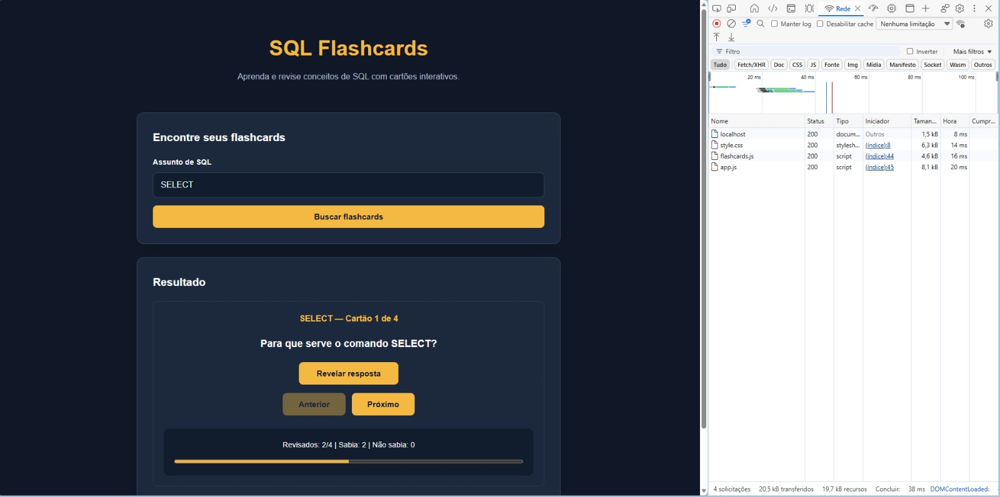
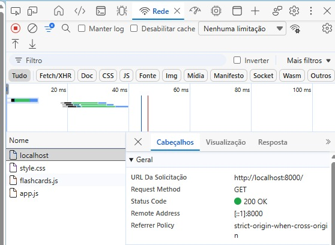

# SQL Flashcards

Aplicação web desenvolvida para a disciplina de Desenvolvimento de Sistemas Web (DSW), da Universidade Federal do Maranhão (UFMA).

## Sobre o projeto

O SQL Flashcards é uma ferramenta interativa para estudantes e iniciantes em bancos de dados que desejam revisar conceitos da linguagem SQL.

O usuário pode pesquisar assuntos, visualizar perguntas, revelar respostas e avaliar seus conhecimentos. O aplicativo também permite acompanhar o progresso dos estudos.

## Funcionalidades

- Pesquisa de flashcards por assunto.
- Exibição de perguntas e respostas.
- Navegação entre os cartões.
- Autoavaliação com as opções "Sabia" e "Não sabia".
- Acompanhamento do progresso de revisão.
- Armazenamento local das avaliações.
- Recuperação do último assunto estudado.
- Validação de campos vazios e assuntos inexistentes.
- Interface responsiva.

## Assuntos disponíveis

- SELECT
- WHERE
- JOIN
- GROUP BY
- ORDER BY
- CTE

O aplicativo contém 24 flashcards, distribuídos entre os seis assuntos.

## Tecnologias utilizadas

- HTML5 — estrutura da página.
- CSS3 — estilização e responsividade.
- JavaScript — lógica e interação.
- localStorage — persistência dos dados.
- Git e GitHub — versionamento e publicação.

O projeto segue a Trilha C (sem API), utilizando HTML, CSS e JavaScript sem frameworks.

## Como executar

1. Clone o repositório ou baixe o projeto em ZIP.
2. Abra a pasta do projeto no VS Code.
3. Inicie um servidor local no terminal:

```bash
python -m http.server 8000
```

4. Acesse no navegador:

http://localhost:8000

Também é possível utilizar a extensão Live Server do VS Code.

## Como utilizar

1. Digite um assunto de SQL no campo de pesquisa.
2. Clique em "Buscar flashcards".
3. Leia a pergunta apresentada.
4. Clique em "Revelar resposta".
5. Marque "Sabia" ou "Não sabia".
6. Utilize os botões de navegação para revisar outros cartões.

As avaliações são armazenadas no navegador com localStorage, permitindo recuperar o progresso após atualizar ou reabrir a aplicação no mesmo navegador, enquanto os dados estiverem disponíveis.

## Evidência da aba Rede (Network)

A imagem abaixo apresenta a aba Rede das ferramentas de desenvolvedor do navegador durante o carregamento do aplicativo.




A captura mostra a requisição HTTP GET utilizada para carregar a página pelo servidor local, com a URL e o código de status da resposta. O status 200 indica que o recurso foi carregado com sucesso, demonstrando a comunicação entre o navegador e o servidor.

## Cuidados e segurança

- Validação de campos vazios.
- Tratamento de pesquisas por assuntos não cadastrados.
- Utilização de textContent para inserir textos na página.
- Ausência de chaves de API e credenciais.
- Armazenamento local de informações de progresso.

## Uso de inteligência artificial

Foi utilizado o ChatGPT, da OpenAI, como ferramenta de apoio ao planejamento e desenvolvimento do projeto.

A ferramenta auxiliou na estilização CSS e identificação de problemas em JavaScript. Na implementação de algumas funcionalidades e na organização da documentação.

O discente participou da definição do escopo, realizou a implementação orientada, construiu e testou as funcionalidades e efetuou ajustes durante o desenvolvimento.

## Autor

Leonardo Ferreira

Universidade Federal do Maranhão — Engenharia da Computação

Disciplina: Desenvolvimento de Sistemas Web
